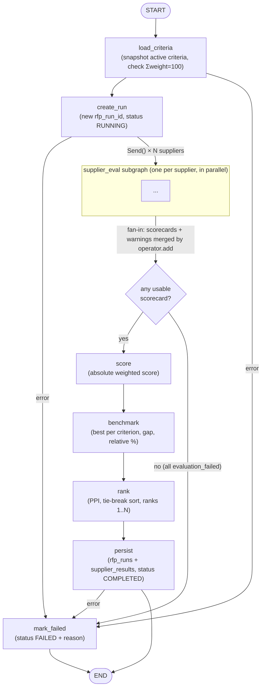
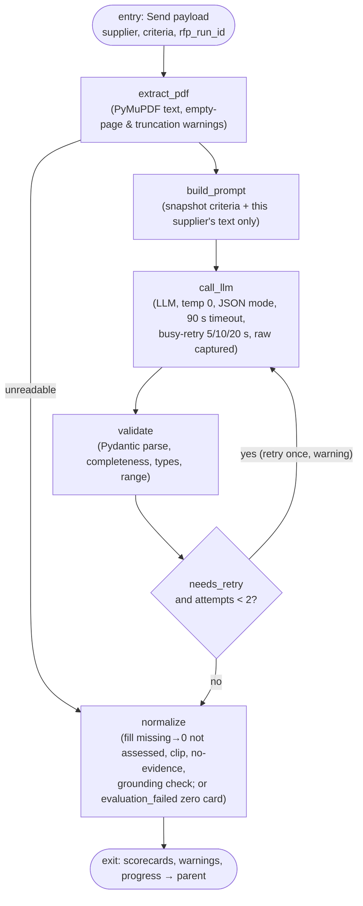

# Architecture — Agentic RFP Evaluation and Supplier Ranking

Streamlit UI → LangGraph parent graph `rfp_run_graph` → per-supplier `supplier_eval` subgraph
(the only place an LLM is called) → pure-Python scoring → SQLite. Spec:
[specs/001-rfp-supplier-ranking/spec.md](../specs/001-rfp-supplier-ranking/spec.md).

**Core rule**: the LLM judges proposal content (score, justification, evidence, risks, summary).
Python computes every total, benchmark, gap, relative %, PPI, tie-break, and rank.

## 1. Graphs

### 1.1 Parent graph `rfp_run_graph`



### 1.2 Subgraph `supplier_eval`



## 2. State schemas

### 2.1 `RFPRunState` (parent)

```python
class RFPRunState(TypedDict, total=False):
    rfp_run_id: str
    criteria: tuple[Criterion, ...]                     # snapshot, immutable for the run
    suppliers: list[SupplierInput]
    scorecards: Annotated[list[Scorecard], operator.add]     # SHARED with subgraph
    warnings:   Annotated[list[Warning], operator.add]       # SHARED with subgraph
    progress:   Annotated[list[ProgressEvent], operator.add] # SHARED with subgraph
    benchmarks: dict[int, float]
    leaderboard: list[RankedSupplier]
    tie_break_explanation: list[str]
    status: Literal["RUNNING", "COMPLETED", "FAILED"]
    error: str | None
```

### 2.2 `SupplierEvalState` (subgraph)

```python
class SupplierEvalState(TypedDict, total=False):
    # input (from Send payload)
    supplier: SupplierInput
    criteria: tuple[Criterion, ...]
    rfp_run_id: str
    # PRIVATE — never leaves the subgraph
    text: str
    messages: list[BaseMessage]
    raw_llm: list[AttemptRecord]
    attempts: int
    parsed: RawLLMEvaluation | None
    needs_retry: bool
    # SHARED — returned to parent and merged
    scorecards: Annotated[list[Scorecard], operator.add]
    warnings:   Annotated[list[Warning], operator.add]
    progress:   Annotated[list[ProgressEvent], operator.add]
```

### 2.3 Shared vs private keys

| Key | Parent | Subgraph | Reducer | Why |
|---|---|---|---|---|
| scorecards | ✓ | ✓ (output) | `operator.add` | N parallel branches each append 1 scorecard; `score` re-sorts by `supplier_index` → deterministic |
| warnings | ✓ | ✓ (output) | `operator.add` | branches + scoring nodes append; sorted by (supplier_index, criterion_id, issue) for display/persist |
| progress | ✓ | ✓ (output) | `operator.add` | per-supplier UI status from stream |
| supplier, criteria, rfp_run_id | ✓ | input only | overwrite | passed in `Send()` payload |
| text, messages, raw_llm, attempts, parsed, needs_retry | ✗ | **private** | overwrite | doc text/LLM internals isolated per supplier (FR-009, FR-035); raw_llm copied into the scorecard's `attempts` |
| benchmarks, leaderboard, tie_break_explanation, status, error | ✓ | ✗ | overwrite | written once, by a single sequential node |

## 3. Node table

| Graph | Node | Input (state keys) | Output (state keys) | Type |
|---|---|---|---|---|
| parent | load_criteria | — (db_path from config) | criteria | Deterministic (SQLite read) |
| parent | create_run | criteria, suppliers | rfp_run_id, status=RUNNING | Deterministic (SQLite insert) |
| parent | *(fan-out edge)* | suppliers, criteria, rfp_run_id | `Send("supplier_eval", …)` × N | Deterministic |
| sub | extract_pdf | supplier.pdf_bytes | text, warnings (pages_without_text, document_truncated, extraction_failed) | Deterministic (PyMuPDF) |
| sub | build_prompt | criteria, supplier.supplier_name, text | messages | Deterministic |
| sub | call_llm | messages, attempts | raw_llm (+1 AttemptRecord), attempts+1, warnings (busy_retry, call_failed) | **LLM** |
| sub | validate | raw_llm[-1], criteria, attempts | parsed, needs_retry, warnings (retry) | Deterministic (Pydantic) |
| sub | normalize | parsed, criteria, text, supplier, raw_llm | scorecards [1], warnings (fixes), progress | Deterministic |
| parent | score | scorecards, criteria | scorecards (+absolute_score, weighted_contribution) | Deterministic → `scoring.score` |
| parent | benchmark | scorecards, criteria | benchmarks, scorecards (+benchmark, gap, relative_pct), warnings (zero_benchmark) | Deterministic → `scoring.benchmark` |
| parent | rank | scorecards, criteria | leaderboard, tie_break_explanation | Deterministic → `scoring.rank` |
| parent | persist | everything above | status=COMPLETED | Deterministic (SQLite write) |
| parent | mark_failed | error | status=FAILED (+failure_reason in DB) | Deterministic |

`score`, `benchmark`, `rank` nodes are 3-line wrappers; the functions in `rfp_eval/scoring/`
import nothing from LangGraph or LangChain and are unit-tested directly.

## 4. SQLite schema

```sql
CREATE TABLE IF NOT EXISTS evaluation_criteria (
  criterion_id INTEGER PRIMARY KEY,
  name         TEXT    NOT NULL UNIQUE,
  description  TEXT    NOT NULL,
  weight       INTEGER NOT NULL CHECK (weight BETWEEN 0 AND 100),
  max_score    REAL    NOT NULL CHECK (max_score > 0),
  is_active    INTEGER NOT NULL DEFAULT 1 CHECK (is_active IN (0,1))
);
CREATE TABLE IF NOT EXISTS rfp_runs (
  rfp_run_id      TEXT PRIMARY KEY,
  created_at      TEXT NOT NULL,
  status          TEXT NOT NULL CHECK (status IN ('RUNNING','COMPLETED','FAILED')),
  failure_reason  TEXT,
  criteria_json   TEXT NOT NULL,
  result_json     TEXT
);
CREATE TABLE IF NOT EXISTS supplier_results (
  rfp_run_id        TEXT NOT NULL REFERENCES rfp_runs(rfp_run_id),
  supplier_name     TEXT NOT NULL,
  submission_date   TEXT NOT NULL,
  experience_rating INTEGER NOT NULL,
  absolute_score    REAL NOT NULL,
  ppi               REAL NOT NULL,
  final_rank        INTEGER NOT NULL,
  result_json       TEXT NOT NULL,
  PRIMARY KEY (rfp_run_id, supplier_name)
);
```

Created + seeded (`INSERT OR IGNORE`) by `rfp_eval.db.connection.init_db()` on every app start,
because Streamlit Community Cloud's disk is ephemeral. Runs left `RUNNING` are set to `FAILED`
("interrupted") at start. Default criteria: Technical Capability 30, Implementation Plan 20,
Commercial Value 20, Security & Compliance 20, Support & Experience 10 (max score 10 each).

## 5. End-to-end data flow (10 steps of the brief)

| # | Step | Where it happens |
|---|---|---|
| 1 | **Setup** — start Streamlit; load active criteria from SQLite | `app.py` → `init_db()`, `repository.list_criteria()`; criteria editor shows weights + total |
| 2 | **Input** — upload PDFs, enter supplier metadata | `app.py` form → `tools.intake.validate_batch()` (type, size, text ≥ 200 chars, duplicates, dates, rating); Evaluate disabled until clean, ≥ 2 suppliers, Σweight = 100, API key present |
| 3 | **Batch** — create supplier entries; generate run ID | graph input `suppliers`; node `create_run` (uuid, `rfp_runs` row RUNNING) |
| 4 | **Evaluate** — reload criteria; extract text; build prompt; call LLM | `load_criteria` (snapshot) → `Send()` → `extract_pdf` → `build_prompt` → `call_llm` |
| 5 | **Validate** — parse JSON; normalize invalid results | `validate` (+ one retry loop) → `normalize` |
| 6 | **Score** — absolute weighted score | `score` → `scoring.score.absolute_score` |
| 7 | **Benchmark** — best per criterion; peer metrics | `benchmark` → `scoring.benchmark` (benchmark, gap, relative %, zero-benchmark rule) |
| 8 | **Rank** — PPI; tie-breaks; sequential ranks | `rank` → `scoring.rank` (PPI, stable sort, explanation) |
| 9 | **Persist** — write results under one RFP_RUN_ID | `persist` → `repository.save_run_result()`; status COMPLETED (or `mark_failed`) |
| 10 | **Present** — leaderboard, evidence, comparisons, JSON download | `app.py` renders final streamed state / reopened `result_json`; `st.download_button` |

## 6. Brief components → graph nodes

| Brief component | Responsibility | Implemented by |
|---|---|---|
| Orchestrator Agent | Controls workflow, calls tools in order | `rfp_eval/graph/rfp_run_graph.py` (parent graph, `Send()` fan-out, conditional routing, `mark_failed`) |
| Document Tool | Extracts clean text from each PDF | `rfp_eval/tools/pdf_tool.py` → node `extract_pdf` (and pre-run checks in `tools/intake.py`) |
| Evaluation Agent | Scores one supplier with cited evidence | `rfp_eval/agents/prompt.py` + `agents/evaluator.py` → nodes `build_prompt`, `call_llm` |
| Validation Tool | Schema check, fill missing, clip, warnings | `rfp_eval/tools/validation.py` + `schemas/` → nodes `validate`, `normalize` (with retry edge) |
| Ranking Tool | Formulas, peer comparison, tie-breaks, rank | `rfp_eval/scoring/` (pure) → nodes `score`, `benchmark`, `rank` |

Persistence (`rfp_eval/db/`) backs `load_criteria`, `create_run`, `persist`, `mark_failed`.

## 7. Cross-cutting

- **Determinism**: temperature 0; fan-in re-sorted by `supplier_index`; PPI compared exactly via
  `fractions.Fraction`; full precision stored; rounding only in UI.
- **Isolation**: each `Send()` payload contains one supplier's bytes; prompt contains only that
  text; evidence grounding checked against that text.
- **Retries**: exactly one evaluation retry (graph edge); up to 3 busy-retries inside `call_llm`;
  client `max_retries=0`.
- **Secrets**: `OPENAI_API_KEY` from `st.secrets` or env; never committed.
- **UI**: `app.py` only calls `graph.stream(..., stream_mode="updates", subgraphs=True)` and
  renders; no business logic.
